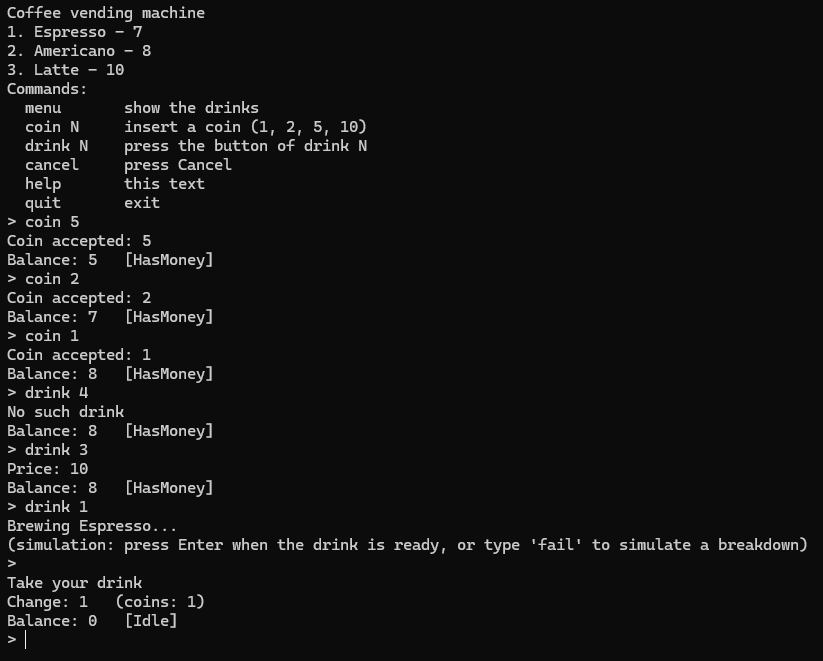
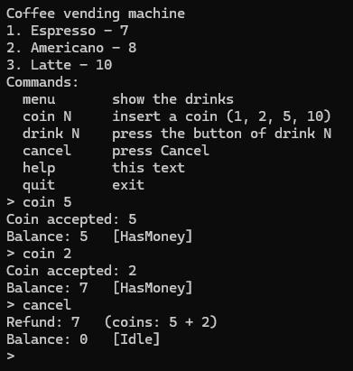
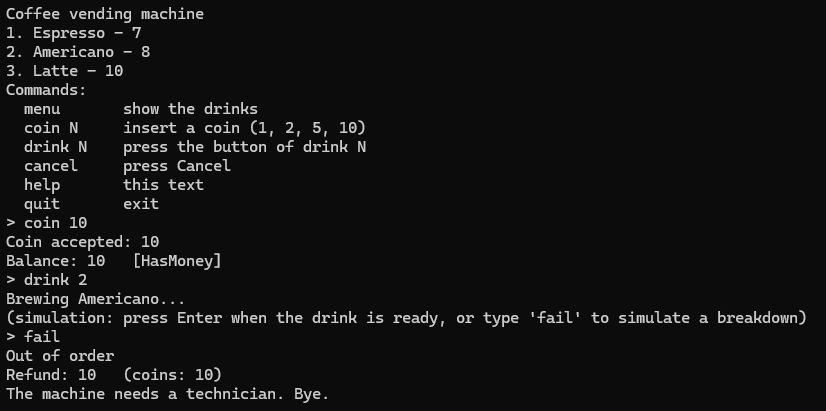

# Vending Machine

A C++17 implementation of a coffee vending machine, structured as a small library with a console front end. The machine is modeled as an explicit finite-state machine, with behavior specified by a transition table and tested for every defined transition.

The core library performs no direct I/O. All user-visible output goes through a UI abstraction that writes to any std::ostream: the console application uses std::cout, while the tests use an in-memory stream to verify what the machine displays.

---

## Using it

    cmake -B build
    cmake --build build
    ./build/app/vending_app

The machine starts with three drinks, some coins for change and a stock of
ingredients - what a technician would load in the morning.

| Command    | What it does                                   |
|------------|------------------------------------------------|
| `menu`     | show the drinks                                |
| `coin N`   | insert a coin; 1, 2, 5 and 10 are accepted     |
| `drink N`  | press the button of drink N                    |
| `cancel`   | press Cancel                                   |
| `help`     | list the commands                              |
| `quit`     | exit                                           |

There is no hardware, so the console also plays the part of the brewer:
while a drink is being made, Enter means "ready" and `fail` simulates a
breakdown.

A session:

    > coin 5
    Coin accepted: 5
    Balance: 5   [HasMoney]
    > drink 3
    Price: 10
    Balance: 5   [HasMoney]
    > cancel
    Refund: 5   (coins: 5)
    Balance: 0   [Idle]

---

## Requirements

- Coins accepted: 1, 2, 5, 10. Any other coin is rejected before it reaches
  the machine.
- The user inserts coins, then presses a drink button.
- Not enough money: the price is shown, the machine waits for more coins.
- An ingredient is missing: "Sold out", the balance stays.
- The change cannot be paid: "Exact change only", the balance stays.
- Cancel before brewing starts: the whole balance comes back.
- While brewing, coins and buttons are ignored.
- Brewing fails: the whole amount comes back, the machine goes out of order.
- Service mode (refilling, prices, collecting the cash) is out of scope.

---

## Design

### Entities

| Class            | Responsibility                                                    |
|------------------|-------------------------------------------------------------------|
| `VendingMachine` | Context of the State pattern: owns everything, forwards events    |
| `State` + 5 kids | one class per state, one virtual method per event                 |
| `CoinSystem`     | balance, escrow (the customer's coins), cash, change              |
| `Brewer`         | stock of ingredients; checks and runs a recipe                    |
| `Menu` / `Drink` | name, price and recipe of every drink                             |
| `UI`             | output only: shows prices and messages                            |

### States and events

Five states: `Idle` (balance 0), `HasMoney` (balance above 0), `Brewing`,
`Dispensing` (paying money out) and `OutOfOrder`.

Six events: a coin, a drink button and Cancel come from the user; *brew
done* and *brew failed* come from the brewer; *coins dispensed* comes from
the coin system.

A state is a situation the machine stays in and waits; an event is an
instant. Checks such as "is there enough money" are neither: they are
conditions that choose which transition to take.

### Transition table

The whole behaviour of the machine, and the specification the code and the
tests were written from.

Entry actions - run on every entry into the state, whatever the way in:

- `Dispensing`: pay the balance out
- `OutOfOrder`: pay the balance out, show "Out of order"

| #  | State      | Event           | Condition             | Actions                   | Next       |
|----|------------|-----------------|-----------------------|---------------------------|------------|
| 1  | Idle       | coin            |                       | deposit                   | HasMoney   |
| 2  | Idle       | drink button    |                       | show price                | Idle       |
| 3  | Idle       | cancel          |                       |                           | Idle       |
| 4  | HasMoney   | coin            |                       | deposit                   | HasMoney   |
| 5  | HasMoney   | cancel          |                       |                           | Dispensing |
| 6  | HasMoney   | drink button    | not enough money      | show price                | HasMoney   |
| 7  | HasMoney   | drink button    | no ingredients        | "Sold out"                | HasMoney   |
| 8  | HasMoney   | drink button    | change cannot be paid | "Exact change only"       | HasMoney   |
| 9  | HasMoney   | drink button    | all checks passed     | reserve price; brew       | Brewing    |
| 10 | Brewing    | brew done       | change > 0            | commit; "Take your drink" | Dispensing |
| 11 | Brewing    | brew done       | change = 0            | commit; "Take your drink" | Idle       |
| 12 | Brewing    | brew failed     |                       |                           | OutOfOrder |
| 13 | Dispensing | coins dispensed |                       |                           | Idle       |

Any pair of state and event that is not in the table is ignored.

Handling one event always goes the same way: exit action of the old state,
transition actions, switch, entry action of the new state - and the next
event waits until all of it is done.

---

## Design decisions

**The State pattern, with empty defaults.** `State` has one virtual method
per event, each doing nothing by default. A state overrides only the events
it reacts to, so the empty base method *is* the "ignored" cell of the table.
Every override is marked `override`, so a typo in a signature is a compile
error instead of an event silently ignored.

**The states are plain members of the machine.** Five fields, no heap, no
indices; `current_` points at one of them, and a transition reads
`setState(brewing_)`. For the same reason the machine cannot be copied or
moved: a copy would point into the original.

**No singleton.** Every test needs its own clean machine with its own cash
and stock. `main` simply creates one object.

**Escrow.** The customer's coins are kept apart until the drink is ready.
Cancel or a breakdown gives back exactly those coins, so a refund never
depends on whether the cash happens to hold the right change. Only
`commit()`, after a successful brew, moves them into the cash. As a result
there is a single "pay out" operation for every case.

**Money is an `int`.** Whole shekels. Floating point cannot represent most
decimal amounts exactly, and money compared with `<` must be exact.

**Ingredients are an `enum class`.** A misspelt string key would silently
create a new, empty ingredient; a misspelt enum value does not compile.

**The recipe lives inside `Drink`.** A separate table of recipes indexed by
drink number would be a second source of truth that can drift from the menu.
The `Brewer` takes a `Recipe`, not a `Drink`: names and prices are not its
business.

**The UI only shows.** It stores nothing and decides nothing; the data comes
from the caller. Reading the keyboard is not its job either - that belongs to
the console in `app/`. Numbering for humans ("button 1") is translated to
program numbering (`DrinkId` 0) at that edge.

**A transition action, not an entry action, starts the brewer.** Starting to
brew needs to know *which* drink was chosen, and only the drink-button
handler has that. An entry action would need the choice stored in an extra
field just to read it back.

---

## Testing

GitHub Actions builds and tests every push with GCC, Clang, GCC with
sanitizers and MSVC, warnings treated as errors - that is the badge at the
top of this page.

Every test is an ordinary program that returns 0 when all its checks pass;
`ctest` runs them.

    ctest --test-dir build

- `test_coin_system` - balance, reservation, commit, change, escrow refund.
- `test_vending_machine` - one scenario per group of rows of the transition
  table, driven only through the machine's public events and checked through
  what is visible from outside: the state, the balance, the brewer's stock
  and the text the UI has shown.

The tests were also checked the other way round: deliberately breaking the
code they cover makes them fail.

---

## Layout

| Folder              | Contents                                                |
|---------------------|---------------------------------------------------------|
| `include/vending/`  | the library: machine, states, coin system, brewer, menu, UI |
| `src/`              | the library sources                                     |
| `app/`              | console front end                                       |
| `tests/`            | tests                                                   |

## Building

Visual Studio: **File > Open > Folder**, choose this folder; Visual Studio
configures CMake by itself.

Elsewhere:

    cmake -B build
    cmake --build build
    ctest --test-dir build

The build turns on a wide set of warnings (`/W4` and more on MSVC, `-Wall
-Wextra -Wpedantic -Wconversion -Wshadow` and more on gcc and clang).
`-DVENDING_WERROR=ON` makes them errors; `-DVENDING_SANITIZE=ON` adds
AddressSanitizer and UndefinedBehaviorSanitizer on gcc and clang.

---

## Known limitations

- Change is paid by a greedy algorithm, largest coins first. With a limited
  cash it can refuse an amount that is actually possible: from 5 + 2 + 2 + 2
  it cannot make 6, although 2 + 2 + 2 would do.
- There is no service mode, so after a breakdown the machine stays out of
  order.

## License

MIT - see [LICENSE.txt](LICENSE.txt).
